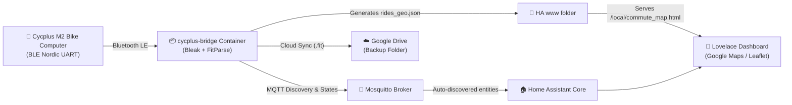

# CycplusHA 🚴⚡
> **Automated Bluetooth (BLE) FIT Activity Sync & Interactive GPS Route Dashboard for Home Assistant**

[](https://www.home-assistant.io/)
[](https://www.python.org/)
[](https://www.bluetooth.com/)
[](https://mosquitto.org/)
[](https://opensource.org/licenses/MIT)

**CycplusHA** is an automated local bridge and dashboard solution for **CYCPLUS M2** (and compatible XOSS / iGPSPORT) GPS bike computers. 

Whenever you return home from a bike ride or commute, the bridge passively detects your bike computer over Bluetooth Low Energy, securely connects, downloads only new `.fit` activity logs, extracts GPS coordinates, and publishes real-time telemetry and routes directly into **Home Assistant** — completely offline without relying on third-party cloud apps.

---

## 🌟 Key Features

- 🔋 **Zero Battery Drain "Smart Arrival" State Machine:**
  - Performs **passive Bluetooth scanning** when away or asleep (0% battery drain on bike computer).
  - Connects **once** upon returning home, downloads newly saved activity logs, and immediately disconnects.
  - Enters a **sleep lock** while the bike computer remains parked at home, allowing the device's native auto-power-off timer to trigger undisturbed.
- ⚡ **Auto-Discovery via MQTT:**
  - Automatically registers battery level, free flash memory, total rides, last ride metrics, and connection state under Home Assistant devices.
- 🗺️ **Interactive Google Maps / Satellite Dashboard Card:**
  - High-resolution interactive GPS map embedded into Lovelace dashboards via Leaflet.
  - Instant layer switcher: **Google Hybrid**, **Google Streets**, **Google Satellite**, **Google Terrain**, and **OpenStreetMap**.
  - Dropdown menu to pick and analyze any past ride with start (🟢) and finish (🏁) markers, distance, duration, and average speed badges.
- 📁 **Incremental & Reliable Transfers:**
  - Avoids re-downloading files that already exist on disk.
  - Automatically downsamples and caches GeoJSON coordinates (`rides_geo.json`) for buttery smooth rendering in web and mobile apps.
- ☁️ **Automated Google Drive Cloud Backup:**
  - Automatically syncs downloaded `.fit` activities to a remote Google Drive folder.
  - Skips already-backed-up files (idempotent, no duplicated uploads).
  - Designed for 24/7 headless Docker operation via Google Cloud Service Account (zero token expiration or manual browser refresh required).
  - Reports cloud backup health and sync status directly to Home Assistant via `sensor.cycplus_m2_gdrive_status`.

---

## 📐 Architecture



---

## 📋 Hardware Requirements

- **Cycplus M2** GPS Bike Computer (or compatible Nordic UART cycling computers).
- Any Linux host, Raspberry Pi, Intel NUC, or Home Assistant server equipped with a standard **Bluetooth 4.0+ adapter** (built-in or USB dongle).
- An active MQTT broker (e.g. Eclipse Mosquitto Add-on in Home Assistant).

---

## 🚀 Quick Start Guide

### 1. Find Your Cycplus MAC Address

Turn on your Cycplus M2. Run a quick scan from any machine with Bluetooth:
```bash
python -m bleak.cli
```
Look for an advertised device named `M2_XXXX` (e.g., `M2_XXXX`, MAC address `AA:BB:CC:11:22:33`).

---

### 2. Run with Docker Compose

Create a `docker-compose.yml` file:

```yaml
services:
  cycplus-bridge:
    image: python:3.11-slim
    container_name: cycplus-bridge
    restart: unless-stopped
    network_mode: host
    privileged: true
    environment:
      # Replace with your MQTT broker IP
      - MQTT_BROKER=192.168.1.22
      - MQTT_PORT=1883
      - MQTT_USER=ha_mqtt
      - MQTT_PASS=your_mqtt_password
      # Replace with your device name and Bluetooth MAC address
      - TARGET_NAME=M2_XXXX
      - TARGET_MAC=AA:BB:CC:11:22:33
      - SCAN_INTERVAL_SECONDS=15
      - DOWNLOAD_DIR=/app/rides
      - WWW_DIR=/mnt/Container/hass/www
      # Google Drive Backup (Optional: replace with your destination folder ID)
      - GDRIVE_FOLDER_ID=YOUR_GOOGLE_DRIVE_FOLDER_ID
    volumes:
      # Host Bluetooth D-Bus socket (Required for BlueZ BLE)
      - /run/dbus/system_bus_socket:/run/dbus/system_bus_socket
      # Storage for downloaded FIT files
      - ./rides:/app/rides
      # Mount directly to Home Assistant www directory
      - /mnt/Container/hass/www:/mnt/Container/hass/www
    command: >
      sh -c "pip install --no-cache-dir bleak paho-mqtt fitparse &&
             python -u /app/cycplus_bridge.py"
```

Start the container:
```bash
docker compose up -d
```

---

### 3. Deploy the Interactive GPS Map Card

1. Copy [`www/commute_map.html`](www/commute_map.html) into your Home Assistant `www/` configuration directory (accessible via `/local/commute_map.html`).
2. The bridge will automatically generate and update `rides_geo.json` in the same directory every time new rides are downloaded.

---

### 4. Import the Lovelace Dashboard

Add the dashboard configuration to your Home Assistant:
- If using **YAML Mode**: copy [`dashboards/cycplus_dashboard.yaml`](dashboards/cycplus_dashboard.yaml) into your dashboard configuration.
- If using **UI / Storage Mode**: go to **Settings ➔ Dashboards ➔ Add Dashboard ➔ Raw configuration editor** and paste the contents of [`dashboards/cycplus_dashboard.json`](dashboards/cycplus_dashboard.json).

---

### 5. ☁️ Google Drive Cloud Backup Setup (Optional)

The bridge can automatically back up all downloaded `.fit` activity files to Google Drive.

#### Method 1: Rclone (Recommended — Zero Google Cloud Setup!)
[Rclone](https://rclone.org/) uses its built-in official OAuth application, so you do **not** need to create any Google Cloud project or API keys.

1. Install rclone on your personal PC (or run `rclone` in PowerShell/terminal):
   ```bash
   # On Windows (winget):
   winget install Rclone.Rclone
   # On macOS (Homebrew):
   brew install rclone
   ```
2. Run the interactive authorization:
   ```bash
   rclone authorize "drive"
   ```
   * Your web browser will open automatically asking you to log into Google and grant Drive access.
   * Click **Allow**.
   * The terminal will output a JSON token block like:
     ```json
     {"access_token":"ya29...","token_type":"Bearer","refresh_token":"1//...","expiry":"2026-..."}
     ```
3. Create an `rclone.conf` file with the following contents:
   ```ini
   [gdrive]
   type = drive
   scope = drive
   root_folder_id = YOUR_GOOGLE_DRIVE_FOLDER_ID
   token = {"access_token":"PASTE_YOUR_ACCESS_TOKEN","token_type":"Bearer","refresh_token":"PASTE_YOUR_REFRESH_TOKEN","expiry":"PASTE_EXPIRY"}
   ```
4. Place `rclone.conf` in your project folder (or `/mnt/Container/cycplus/rclone.conf`).
5. That's it! The bridge automatically detects `rclone.conf`, syncs existing `.fit` rides on startup, and uploads new rides immediately after each sync session.

---

#### Method 2: Google Cloud Service Account (Alternative)
If you already use Google Cloud Platform:
1. Go to [Google Cloud Console](https://console.cloud.google.com/) and create a project.
2. Enable the **Google Drive API**.
3. Create a **Service Account** and generate a **JSON key** saved as `service_account.json`.
4. Share your target Google Drive folder with the service account's email as **Editor**.
5. Place `service_account.json` in the container/project directory.

---

## 📊 Home Assistant Entities

The bridge automatically provisions the following entities under device **`Cycplus M2`**:

| Entity ID | Name | Description |
|---|---|---|
| `sensor.cycplus_m2_status` | Status | Live connection status (`Standby`, `Connecting`, `Home (Synced)`) |
| `sensor.cycplus_m2_battery` | Battery | Battery level percentage (`%`) |
| `sensor.cycplus_m2_last_sync` | Last Sync | Timestamp of most recent synchronization |
| `sensor.cycplus_m2_disk_free` | Free Disk Space | Remaining flash storage on bike computer (`KB`) |
| `sensor.cycplus_m2_total_rides` | Total Rides | Count of total activities recorded on device |
| `sensor.cycplus_m2_last_ride` | Last Ride | Distance, duration, avg/top speed of latest activity |
| `sensor.cycplus_m2_rides_list` | Downloaded Rides List | Full list with metadata of all synced rides |
| `sensor.cycplus_m2_gdrive_status` | Google Drive Status | Cloud backup status (`Connected`, `Dormant`), folder URL, and backed up file count |

---

## 📡 Bluetooth Communication Reference

The Cycplus M2 BLE communication protocol and Nordic UART file transfer commands implemented in this project are based on the reverse-engineering work and protocol specifications documented by [pcolby/cycplus-m2](https://github.com/pcolby/cycplus-m2) and the open-source Nordic Semiconductor UART GATT service.

---

## 🛠️ Configuration Options

| Variable | Default | Description |
|---|---|---|
| `TARGET_NAME` | `M2_XXXX` | Name prefix of the bike computer (e.g. `M2_XXXX`) |
| `TARGET_MAC` | `AA:BB:CC:11:22:33` | Target device Bluetooth MAC address |
| `MQTT_BROKER` | `192.168.1.22` | Hostname or IP of MQTT broker |
| `MQTT_PORT` | `1883` | Port of MQTT broker |
| `MQTT_USER` | `ha_mqtt` | MQTT username |
| `MQTT_PASS` | `hamqtt` | MQTT password |
| `MQTT_TOPIC_PREFIX` | `cycplus_m2` | Base MQTT discovery topic prefix |
| `DOWNLOAD_DIR` | `/app/rides` | Directory where downloaded `.fit` files are saved |
| `WWW_DIR` | `/mnt/Container/hass/www` | Home Assistant `www` directory for `rides_geo.json` export |
| `SCAN_INTERVAL_SECONDS` | `15` | Polling scan interval when device is away or sleeping |
| `GDRIVE_FOLDER_ID` | `YOUR_GOOGLE_DRIVE_FOLDER_ID` | Google Drive folder ID where `.fit` files are backed up |
| `GOOGLE_APPLICATION_CREDENTIALS` | `service_account.json` | Path to Google Service Account JSON key or OAuth2 credentials |

---

## 📄 License

This project is licensed under the [MIT License](LICENSE).
Contributions, feature suggestions, and pull requests are warmly welcome!
